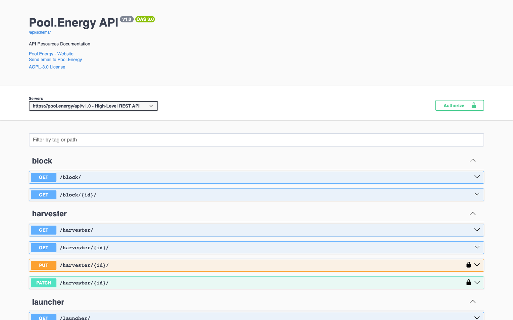

# Pool.Energy — API

[](https://github.com/Pool-Energy/api/actions/workflows/build-and-publish.yml)
[](https://www.django-rest-framework.org)
[](https://www.python.org)
[](LICENSE)



> Swagger UI generated by `drf-spectacular` from this codebase, served by the
> deployed instance at `https://pool.energy/api/doc/`.

The HTTP and WebSocket API for **Pool.Energy**, a Chia farming pool. It exposes
the pool's read models (farmers, blocks, partials, payouts, statistics) over a
versioned REST API, streams live events over WebSockets, and handles launcher
authentication and settings updates.

The service is a Django + DRF application served through ASGI, so REST and
WebSocket traffic share one process. Data is written by the
[pool server](https://github.com/Pool-Energy/pool); this API is mostly a read
layer over PostgreSQL, InfluxDB and Redis.

---

## Table of contents

- [Tech stack](#tech-stack)
- [Features](#features)
- [Getting started](#getting-started)
- [Project structure](#project-structure)
- [Architecture](#architecture)
- [Configuration](#configuration)
- [REST endpoints](#rest-endpoints)
- [WebSocket channels](#websocket-channels)
- [Data model](#data-model)
- [Docker image](#docker-image)
- [Continuous integration](#continuous-integration)
- [Troubleshooting](#troubleshooting)
- [Contributing](#contributing)
- [License](#license)

## Tech stack

| Concern        | Choice                                                                 |
| -------------- | ---------------------------------------------------------------------- |
| Framework      | Django (pulled transitively by `channels`, not pinned directly) + DRF 3.18 |
| Schema / docs  | `drf-spectacular` 0.30 (OpenAPI 3.0, Swagger UI, Redoc)                |
| Realtime       | Django Channels 4.3 + `channels_redis`                                 |
| ASGI server    | gunicorn + `uvicorn.workers.UvicornWorker`                             |
| Database       | PostgreSQL via `psycopg2`                                             |
| Time series    | InfluxDB 2 (`influxdb-client`), bucket `chia_pool`                     |
| Event bus      | Redis pub/sub (`live:*` channels)                                      |
| Chia           | `chia-blockchain` fork `release/2.7.5`, `chia_rs` (BLS signatures)     |
| Misc           | `django-filter`, `qrcode` (SVG login QR), `cachetools`                 |
| License        | AGPL-3.0                                                               |

## Features

- **Versioned REST API** at `/api/v1.0/` with limit/offset pagination,
  filtering, search, ordering and anonymous throttling.
- **Generated OpenAPI 3.0 schema** (`/api/schema/`) plus Swagger UI
  (`/api/doc/`) and Redoc (`/api/redoc/`).
- **Launcher authentication**: a launcher signs a challenge with its BLS key to
  open a session, then manages its settings (name, picture, payout address,
  minimum payout, difficulty, notifications, referral, FCM token).
- **QR-code login**: a signed-in launcher gets a stable token rendered as an
  SVG QR code, which a mobile client can exchange for a session.
- **Live WebSocket feeds** for pool status, blocks, rewards, farmers, partials
  and a per-launcher feed, fed from Redis pub/sub.
- **Pool log streaming** over WebSocket by tailing the pool's JSON logs.
- **Aggregated statistics**: pool size, netspace, mempool, XCH price, effort,
  estimation to win and XCH/TB/month profitability.
- **Referral program** endpoints and an XCHScan-compatible stats endpoint.

## Getting started

### Requirements

- **Python 3.11+** (the image uses Debian bookworm's 3.11)
- **PostgreSQL** reachable from the process
- **Redis** (pub/sub for live events and WebSocket groups)
- **InfluxDB 2** with the `chia_pool` bucket (timeseries endpoints)
- A reachable **pool server** (`POOL_URL`, default `http://localhost:8080`) and
  its `config.yaml` (`POOL_CONFIG_PATH`) for the fee and target address

### Install

```bash
python3 -m venv venv
./venv/bin/pip install -r requirements.txt
```

The `requirements.txt` pulls the Pool.Energy `chia-blockchain` and `pool`
forks from GitHub, so `git` and a working toolchain are needed for the build.

### Configure

Settings are read from a YAML file pointed to by `DJANGO_SETTINGS_FILE`
(`poolenergyapi.utils.custom_settings`). Without it, development defaults apply
(local PostgreSQL `pool/pool/abcd1234`, Redis on `localhost:6379`, no InfluxDB).

```yaml
secret_key: 'change-me'
debug: false
allowed_hosts: ['localhost']
pool_url: 'http://localhost:8080'
database:
  name: pool
  user: pool
  password: secret
  host: postgres
  port: 5432
influxdb:
  url: 'http://influxdb:8086'
  token: 'xxx'
  org: 'poolenergy'
redis:
  host: redis
  port: 6379
```

### Run

```bash
cd src
../venv/bin/python manage.py migrate
../venv/bin/python manage.py runserver 0.0.0.0:8000
```

Production (what the container does):

```bash
../venv/bin/gunicorn -k uvicorn.workers.UvicornWorker \
  --bind 0.0.0.0:8000 poolenergyapi.asgi:application
```

| URL                    | Content                                   |
| ---------------------- | ----------------------------------------- |
| `/api/v1.0/`           | REST API                                  |
| `/api/schema/`         | OpenAPI 3.0 document (YAML)               |
| `/api/doc/`            | Swagger UI                                |
| `/api/redoc/`          | Redoc                                     |
| `/api/auth/`           | DRF browsable session login               |
| `/static/*`            | Collected static files (Caddy on `:8001`) |
| `ws://…/ws/<channel>/` | WebSocket feeds (see below)               |

## Project structure

```
api/
├── docker/
│   ├── caddy/Caddyfile         # Static file server on :8001
│   └── entrypoint.sh           # collectstatic → migrate → caddy → gunicorn
├── docs/screenshot.png         # README screenshot (Swagger UI)
├── src/
│   ├── api/
│   │   ├── auth.py             # Bearer token auth against Launcher.qrcode_token
│   │   ├── consumers.py        # WebSocket consumers, log tailer, Redis relay
│   │   ├── models.py           # Read models shared with the pool server
│   │   ├── renderer.py         # JSON-only browsable API renderer
│   │   ├── routing.py          # WebSocket URL patterns
│   │   ├── serializers.py      # DRF serializers
│   │   ├── urls.py             # /api/v1.0/ routes
│   │   ├── utils.py            # Pool config/API helpers, InfluxDB client
│   │   └── views.py            # ViewSets and APIViews (~1k lines)
│   ├── poolenergyapi/          # Django project (settings, asgi, wsgi, utils)
│   ├── referral/               # Referral app (model, serializer, viewset)
│   └── manage.py
├── Dockerfile                  # Debian + venv + bundled Caddy binary
├── requirements.txt
└── README.md
```

## Architecture

### Settings and bootstrap

`poolenergyapi/settings.py` starts by loading `custom_settings()`, so every
value can come from the YAML file named by `DJANGO_SETTINGS_FILE`. Notable
defaults:

- `REST_FRAMEWORK`: `TokenAuthentication`, `DjangoFilterBackend` +
  `OrderingFilter`, `NamespaceVersioning`, `LimitOffsetPagination` (page size
  100), `AnonRateThrottle` at `1000/hour`, `drf-spectacular` schema class.
- `CHANNEL_LAYERS`: `channels_redis` on `REDIS_HOST`/`REDIS_PORT`.
- `ASGI_APPLICATION = poolenergyapi.asgi.application`, a `ProtocolTypeRouter`
  sending HTTP to Django and WebSocket to `api.routing.websocket_urlpatterns`.
- `SPECTACULAR_SETTINGS`: title, contact, licence, and two post-processing
  hooks that rewrite the version and inject the current server URL.

`POOL_URL` (default `http://localhost:8080`) is used to fetch `/pool_info` from
the pool server; `POOL_CONFIG_PATH` points to the same `config.yaml` to read the
fee and the pool target address.

### Authentication

`api.auth.TokenAuthentication` accepts `Authorization: Bearer <token>` and
looks the value up in `Launcher.qrcode_token`. Authentication is open by
default for read endpoints; only mutations require it:

- `PUT /launcher/{launcher_id}/` requires a session (`?launcher_id` in the
  Django session) **or** a Bearer token matching that launcher.
- `PUT /harvester/{harvester}/` updates a harvester display name.

The login flow is BLS-based: `POST /login` validates a `launcher_id`,
`authentication_token` and `signature` against the launcher's
`authentication_public_key` and its singleton `target_puzzle_hash`, then stores
the launcher in the session. `POST /login_qr` exchanges the QR token for a
session; `GET /qrcode` renders that token as an SVG.

### WebSocket consumers

- `LiveGroupConsumer` is the base class: it accepts the socket, joins the
  Channels groups returned by `get_groups()`, and forwards every group message
  as `{"kind": …, "payload": …}`.
- `RedisRelay` is a singleton per ASGI worker: it `psubscribe`s `live:*` on
  Redis and re-broadcasts each event to the group named after the channel
  (`live:partial:<id>` → group `live_partial_<id>`).
- `PoolLogConsumer` tails `main.log.json` and `partial.log.json` from
  `POOL_LOG_DIR` with `tail -q -F -n 15`, parses JSON lines and lets each client
  subscribe to `partials` and/or `payments` by sending a JSON list.

> **Scaling note** — `RedisRelay` and the log tailer are process-wide
> singletons, and the deployment runs a single gunicorn worker on purpose. If
> the API is ever scaled to several workers or replicas, the relay must move to
> a dedicated process, otherwise clients receive duplicated events.

### Statistics

`StatsView` aggregates PostgreSQL (`Launcher`, `Block`), InfluxDB (`pool_size`,
`mempool`) and the pool's `/pool_info` to build `/stats`: farmers, pool space,
estimate to win, time since last win, blockchain height/space, dust storm flag,
average effort, last rewards, wallets/nodes status and XCH price. The
`*/stats/*` endpoints return InfluxDB timeseries for a `days` window.

## Configuration

| YAML key        | Default            | Description                                  |
| --------------- | ------------------ | -------------------------------------------- |
| `secret_key`    | `django-insecure`  | Django secret key                            |
| `debug`         | `false`            | Django debug mode                            |
| `allowed_hosts` | `['localhost']`    | `ALLOWED_HOSTS`                              |
| `pool_url`      | `http://localhost:8080` | Pool server base URL (for `/pool_info`) |
| `database`      | local `pool` DB    | PostgreSQL connection                        |
| `influxdb`      | *(disabled)*       | `url`, `token`, `org`                        |
| `redis`         | `localhost:6379`   | Redis host/port for Channels and the relay   |

| Environment variable   | Default                              | Description                          |
| ---------------------- | ------------------------------------ | ------------------------------------ |
| `DJANGO_SETTINGS_FILE` | *(unset)*                            | Path to the YAML settings file       |
| `CHIA_NETWORK`         | `mainnet`                            | Sets `CHIA_ROOT=/data/chia/<network>`|
| `POOL_CONFIG_PATH`     | `/data/config.yaml`                  | Pool config (fee, target address)    |
| `POOL_LOG_DIR`         | `/data/pool_log`                     | Directory of the JSON pool logs      |

## REST endpoints

All routes below are prefixed with `/api/v1.0/`.

| Route                       | Methods      | Purpose                                         |
| --------------------------- | ------------ | ----------------------------------------------- |
| `stats`                     | GET          | Aggregated pool statistics                      |
| `xchscan_stats`             | GET          | XCHScan-compatible pool summary                 |
| `message`                   | GET          | Enabled global messages (banner)                |
| `login`                     | POST         | BLS challenge/signature login                   |
| `login_qr`                  | POST         | Session from a QR token                         |
| `qrcode`                    | GET          | SVG QR code of the launcher token               |
| `loggedin`                  | GET          | Current session launcher                        |
| `block/`                    | GET          | Farmed blocks (filter: `farmed_by`, `payout`, `farmed_height`) |
| `launcher/`                 | GET          | Farmers list (search `launcher_id`/`name`, order by points) |
| `launcher/{id}/`            | GET, PUT     | Launcher detail; PUT updates settings (auth)     |
| `partial/`                  | GET          | Partials (filters: `launcher`, `harvester_id`, `timestamp`, `min_timestamp`) |
| `harvester/`                | GET, PUT     | Harvesters per launcher                          |
| `payout/`                   | GET          | Payouts                                          |
| `payoutaddress/`            | GET          | Payout address details per payout/launcher       |
| `payouttransaction/`        | GET          | Payout transactions                              |
| `transaction/`              | GET          | Transactions                                     |
| `referral/`                 | GET          | Active referrals, ordered by total income        |
| `pool_size/`                | GET          | Pool size timeseries (`days`, default 7)         |
| `launcher_size/`            | GET          | Launcher size timeseries (`launcher`, `days`)    |
| `stats/mempool/`            | GET          | Mempool fullness timeseries                      |
| `stats/netspace/`           | GET          | Network space timeseries                         |
| `stats/partial/`            | GET          | Partial throughput timeseries                    |
| `stats/xchprice/`           | GET          | XCH price timeseries                             |

Non-`/api/v1.0/` routes: `/api/schema/`, `/api/doc/`, `/api/redoc/`,
`/api/auth/`.

## WebSocket channels

| Channel                      | Groups joined                          | Payload                             |
| ---------------------------- | -------------------------------------- | ----------------------------------- |
| `ws/pool_status/`            | `live_pool_status`                     | Pool KPI updates                    |
| `ws/pool_stats/`             | `live_pool_status`, `live_partial_all` | Status + partial throughput         |
| `ws/blocks/`                 | `live_block_all`                       | New blocks                          |
| `ws/rewards/`                | `live_payout_all`                      | New payouts                         |
| `ws/farmers/`                | `live_partial_all`, `live_block_all`   | Farmers activity                    |
| `ws/partials/`               | `live_partial_all`, `live_block_all`   | Partials + 15-minute backfill snapshot |
| `ws/farmer/<launcher_id>/`   | `live_partial_<id>`, `live_block_<id>`, `live_payout_<id>` | Everything for one launcher |
| `ws/log/`                    | —                                      | Pool logs (`partials`, `payments`)  |

Events are published by the pool server on `live:<kind>:<scope>` and relayed
as `{"kind": "<kind>", "payload": {…}}`.

## Data model

`api/models.py` defines the read models shared with the pool server:

| Model           | Purpose                                                     |
| --------------- | ----------------------------------------------------------- |
| `Launcher`      | Farmer identity (launcher id, keys, name, picture, points, difficulty, payout settings) |
| `Harvester`     | Harvester instances per launcher (version, name, last seen) |
| `Partial`        | Submitted partials with validation status/error            |
| `PendingPartial`| Partials awaiting confirmation                              |
| `Block`         | Farmed blocks with pool space, effort, luck, payout link   |
| `Payout`        | Payout runs                                                |
| `PayoutAddress` | Per-launcher amounts inside a payout                       |
| `Transaction`   | Wallet transactions                                        |
| `CoinReward`    | Coinbase rewards per block                                 |
| `Singleton`     | Singleton state tracking                                   |
| `Notification`  | Per-launcher notification preferences                      |
| `GlobalInfo`    | Singleton row with blockchain/wallet/node snapshot         |
| `GlobalMessage` | Messages displayed as a banner in the web UI               |

A separate `referral` app stores `Referral` rows (launcher, referrer, total
income, activation date).

## Docker image

`Dockerfile` produces a single Debian `bookworm-slim` image:

1. Creates `/root/venv` and installs `requirements.txt`.
2. Copies `src/` to `/root/api` and the Caddyfile to `/etc/Caddyfile`.
3. Copies the Caddy binary from the `caddy:2.11.7-alpine` stage.

`docker/entrypoint.sh` then:

```bash
python manage.py collectstatic --no-input
python manage.py migrate
caddy start --config /etc/Caddyfile          # :8001, serves /static/*
exec gunicorn -k uvicorn.workers.UvicornWorker \
  --bind 0.0.0.0:8000 poolenergyapi.asgi:application
```

| Port | Service                                    |
| ---- | ------------------------------------------ |
| 8000 | gunicorn / ASGI (REST + WebSocket)         |
| 8001 | Caddy (static files)                       |

## Continuous integration

`.github/workflows/build-and-publish.yml` runs on pushes to `main`,
`feature/*`, `bugfix/*`, `hotfix/*` and `v*.*.*` tags, and on pull requests to
those branches. It builds the Docker image for `linux/amd64` with
`no-cache: true` and pushes it to `ghcr.io/pool-energy/api` (except on pull
requests), tagged with the commit SHA, branch, semver and `latest`.

There is no test suite today (`referral/tests.py` is the Django stub), so CI
validates the image build and the dependency resolution.

## Troubleshooting

| Symptom                                              | Fix                                                                 |
| ---------------------------------------------------- | ------------------------------------------------------------------- |
| `django.db.utils.OperationalError` on startup        | PostgreSQL unreachable or `database` block missing/wrong            |
| `GET /stats` returns zeros for pool size/mempool     | InfluxDB not configured, or the `chia_pool` bucket has no data yet   |
| Live pages never update                              | Redis unreachable: check `redis` settings, `channels_redis` and the relay logs |
| `PoolLogConsumer` returns nothing                    | `POOL_LOG_DIR` must point to the directory holding `main.log.json` and `partial.log.json` |
| `PoolErrorCode`/fee values wrong in `/stats`         | `POOL_URL` or `POOL_CONFIG_PATH` does not match the pool server      |
| WebSocket closes immediately                         | The ASGI server must run with `UvicornWorker` (not WSGI)             |
| Duplicated live events                               | More than one gunicorn worker is running (see the scaling note)      |

## Contributing

Commits follow [Conventional Commits](https://www.conventionalcommits.org/)
(`feat|fix|docs|refactor|test|chore(scope): summary`, English only). Work on a
`<type>/<short-description>` branch and open a pull request against `main`.

## License

Distributed under the **GNU Affero General Public License v3.0** — see
[LICENSE](LICENSE).
